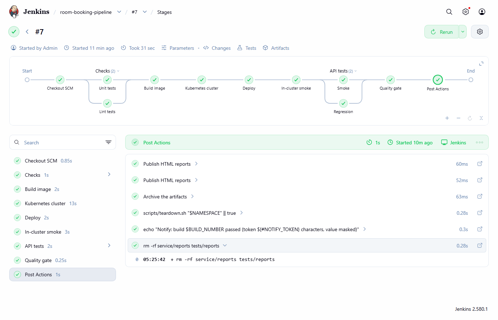
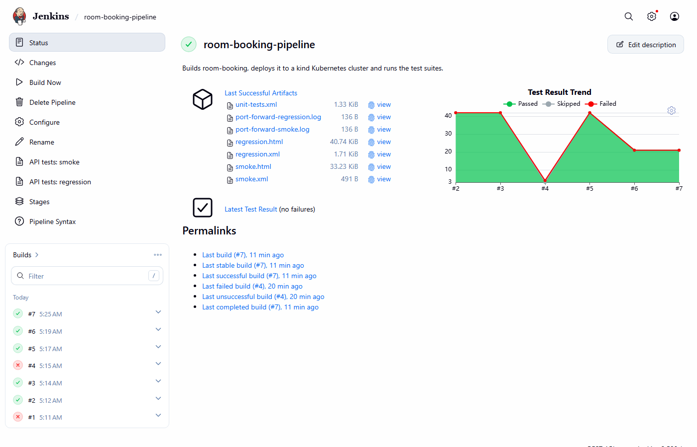
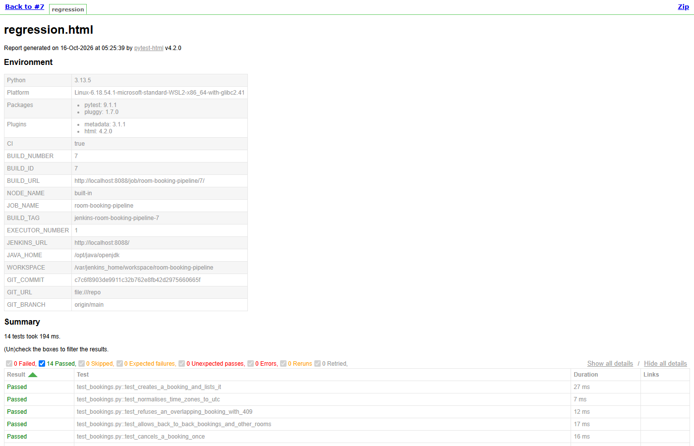

# Jenkins + Kubernetes test pipeline

[](https://github.com/niranjankagri/jenkins-kubernetes-pipeline/actions/workflows/ci.yml)

A Jenkins pipeline, configured entirely as code, that builds a small API, deploys it to a **Kubernetes** cluster
(kind) and runs the test suites against the deployment. GitHub Actions starts the same Jenkins on every push and
fails unless the pipeline passes, so the Jenkinsfile is tested like code.



## What it shows

| Topic | Where |
|---|---|
| **Jenkins as code**: controller image with plugins, JCasC (users, security, credentials), the job created by Job DSL | `jenkins/` |
| **Declarative Jenkinsfile**: parallel stages, parameters, `when`, timeouts, `disableConcurrentBuilds`, post conditions | `Jenkinsfile` |
| Test reporting: JUnit results and trend, published HTML reports, archived artifacts | `Jenkinsfile` |
| **Quality gate**: fails on any failed test and when fewer tests ran than expected | `Jenkinsfile` |
| Credentials: a secret bound with `withCredentials`, masked in the log | `jenkins/casc.yaml`, `Jenkinsfile` |
| Docker image build; docker outside of docker (the controller uses the host's engine) | `service/Dockerfile`, `jenkins/docker-compose.yml` |
| **Kubernetes**: a kind cluster, image loading, a namespace per build, Deployment with readiness/liveness probes, rollout wait | `k8s/`, `scripts/` |
| An in-cluster smoke test as a Kubernetes **Job** | `k8s/smoke-job.yaml` |
| API tests against the deployment through `kubectl port-forward`, smoke and regression in parallel | `scripts/api-tests.sh`, `tests/` |
| The deployment proves its own version (`/version` = build number) | `tests/test_smoke.py` |
| Pipeline logic in scripts, shared by Jenkins and GitHub Actions | `scripts/` |
| **CI runs a real Jenkins**: builds the image, starts it, triggers the job over the REST API, requires SUCCESS | `.github/workflows/ci.yml`, `scripts/run-jenkins-build.sh` |

## The pipeline

| Stage | What happens |
|---|---|
| Checks (parallel) | **Unit tests** of the service (`node:test`, JUnit XML) and **Lint** of the API tests (Ruff) |
| Build image | `docker build -t room-booking:build-<n> service` |
| Kubernetes cluster | create the kind cluster `qa` once (later builds reuse it), load the image into it |
| Deploy | namespace `qa-<n>`, Deployment (2 replicas) + Service, wait for the rollout |
| In-cluster smoke | a Kubernetes Job calls `http://room-booking:8080` inside the cluster and checks the build number |
| API tests (parallel) | **Smoke** (3) and **Regression** (14) pytest suites through port-forward; JUnit + HTML |
| Quality gate | no failed tests, and at least 20 tests ran (6 for the smoke-only choice) |
| Post | publish HTML reports, archive reports, delete the namespace, notify with a masked credential |

Parameters: `TEST_SUITE` (`all` or `smoke`) and `KEEP_NAMESPACE` (keep the deployment for debugging).

## The system under test

**room-booking**, a meeting-room booking API in the repository (Node 24, TypeScript run directly, no
dependencies): rooms, bookings with ISO date-times, overlap conflicts (409), capacity and length rules (400),
`/health` for the probes and `/version` with the build number. 4 unit tests (`service/test`) and 17 API tests
(`tests/`).

## Run it

Needs Docker (Docker Desktop on Windows/macOS). Everything else runs in containers.

```bash
docker compose -f jenkins/docker-compose.yml up -d --build --wait    # Jenkins on http://localhost:8088
scripts/run-jenkins-build.sh                                       # start the job, wait, print the result
```

Log in as `admin` with the password from `JENKINS_ADMIN_PASSWORD` (local default: `admin`). The job builds the
**committed** `main` branch of this repository (mounted read-only at `/repo`).

Without Jenkins (the same scripts, needs `kind`, `kubectl`, Python 3):

```bash
scripts/kind-up.sh
docker build -t room-booking:dev service && kind load docker-image room-booking:dev --name qa
scripts/deploy.sh qa-dev room-booking:dev dev local
scripts/smoke-job.sh qa-dev dev
scripts/python-env.sh && PYTHON=tests/.venv/bin/python scripts/api-tests.sh qa-dev dev regression 18082
```

Stop: `docker compose -f jenkins/docker-compose.yml down` and `kind delete cluster --name qa`.

## Results

- First build on a new machine: **2 min 13 s**, most of it creating the kind cluster. Later builds reuse the
  cluster: **about 30 s**.
- 21 tests per build: 4 unit + 3 API smoke + 14 API regression; the quality gate counts them.
- A deliberately broken overlap rule failed the build in the first stage (unit tests): nothing was built or
  deployed.
- CI: three jobs green (checks, Kubernetes without Jenkins, real Jenkins).

The job page from the first local runs. Build #1 failed while setting up (the unit-report folder), #4 on purpose
(a broken overlap rule). The trend's drop from 42 to 21 tests at #6 is a fix: the first quality gate counted
every test twice (see "Design notes").



The published pytest-html report of the regression suite:



## CI

`.github/workflows/ci.yml`, on every push and pull request:

1. **Unit tests, lint, API tests (local)**: the service started on the runner.
2. **Deploy to kind and test**: the Kubernetes path with the same scripts, without Jenkins.
3. **Jenkins runs the Jenkinsfile**: builds `jenkins/`, starts it with the runner's Docker group, runs
   `scripts/run-jenkins-build.sh`, and fails unless the Jenkins build ends with SUCCESS. The console log is
   kept as an artifact.

## Design notes

- **Everything as code.** No manual Jenkins setup: plugins in `plugins.txt`, configuration in `casc.yaml`, the
  job from Job DSL, the pipeline in the `Jenkinsfile`. A broken Jenkins is replaced, not repaired.
- **Scripts do the work, the Jenkinsfile orchestrates.** The same scripts run in GitHub Actions; the pipeline
  stays short, and moving to another CI tool means a new orchestration file, not new logic.
- **A namespace per build** keeps runs apart and makes cleanup one command; the cluster is reused for speed.
- **Two kinds of deployment checks**: a Job inside the cluster (service discovery works) and API tests from
  outside (the behaviour works).
- **Count tests once.** The first version recorded the JUnit files again in the quality gate, and Jenkins
  showed 42 tests instead of 21; each stage now records once and the gate adds up the summaries.
- **The Groovy sandbox stays on.** CI's Jenkins rejected `Collection.sum()`; a plain loop replaced it instead
  of approving methods by hand.

More: [docs/framework-design.md](docs/framework-design.md).

## Interview guide

Jenkins, pipeline and Kubernetes questions for test automation roles, each answered with a pointer to this
project: [docs/interview-questions.md](docs/interview-questions.md) (also as
[PDF](docs/interview-questions.pdf)).

## Known limitations

- Builds run on the controller (2 executors) for simplicity; a production setup uses agents (static, Docker or
  Kubernetes pods) and no executors on the controller.
- The controller uses the host's Docker socket, which gives it full control of the host's Docker: acceptable for
  a local demo, not for a shared Jenkins.
- Images are loaded into kind, not pushed to a registry; every build's image stays in the cluster until it is
  deleted.
- Plugins are installed at their latest versions when the image is built (pin them for reproducible images).

## License

MIT
